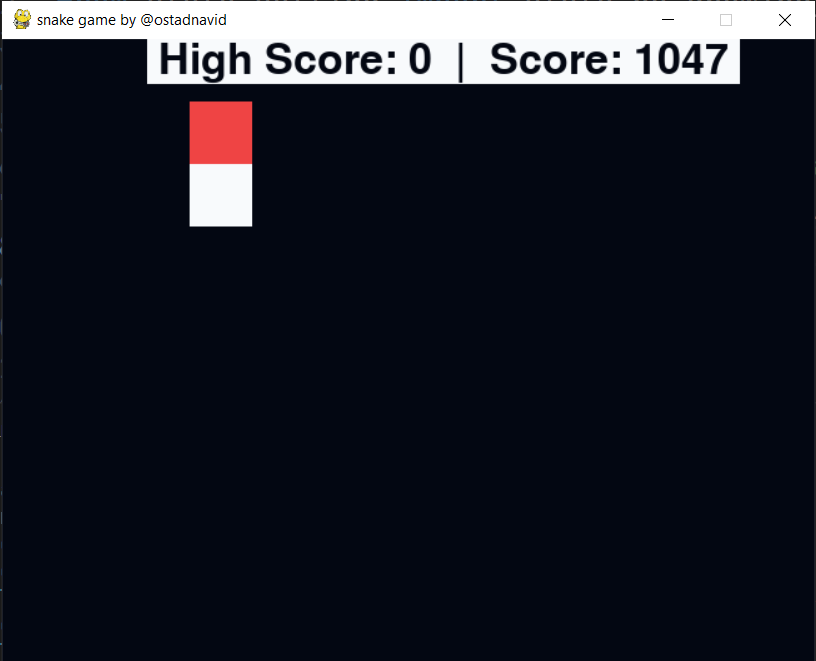
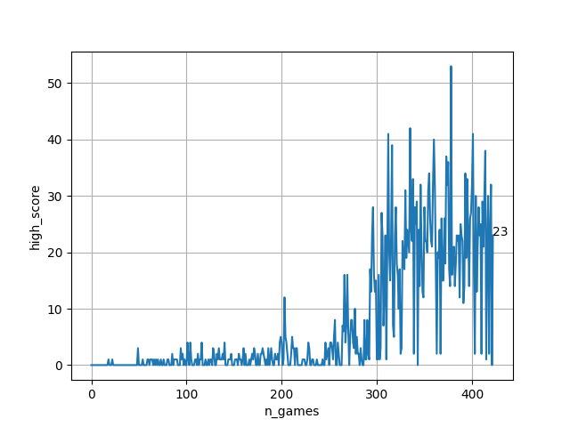
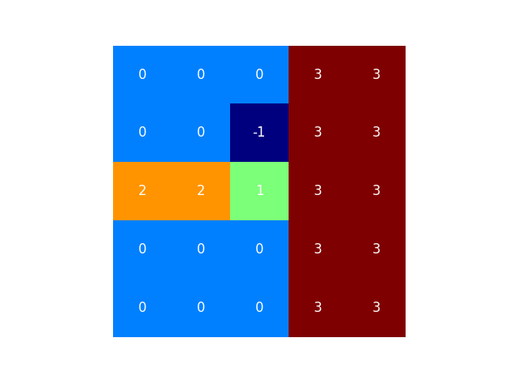
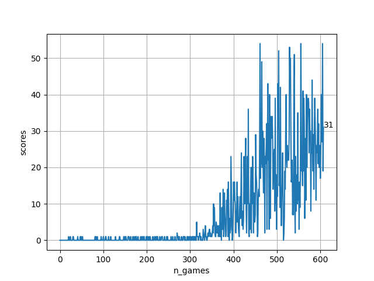

# Snake AI: Reinforcement Learning Experiments

This project implements and compares two reinforcement learning algorithms (Q-Learning and Deep Q-Learning) for training an AI agent to play the Snake game.

## Prerequisites
- Python 3.10
- Required packages: `pip install -r requirements.txt`

## Running the Program
1. Navigate to the project root directory
2. Install dependencies:
   ```bash
   pip install -r requirements.txt
   ```
3. Enter any experiment directory (e.g., `growing_snake_deep_q_learning`)
4. Run the training and testing script:
   ```bash
   python main.py
   ```

## Project Structure
Key files in each experiment directory:
| File             | Description                                                                 |
|------------------|-----------------------------------------------------------------------------|
| `agent.py`       | Implementation of the learning agent (type specified in directory name)     |
| `helper.py`      | Visualization and utility functions                                        |
| `main.py`        | Training and testing pipeline                                              |
| `snake.py`       | Game environment (Gym-like implementation)                                 |
| `state_setting.py`| State representation configuration (customizable inputs for agents)        |

## Experiment Cases
### Case 1: Non-Growing Snake with Q-Learning
**Directory:** `no_growing_snake_q_learning`  
- Simplified version where snake length doesn't increase
- Achieves scores >1000 in <20k training steps  


### Case 2: Standard Snake with Q-Learning
**Directory:** `growing_snake_q_learning`  
- Standard game rules with snake growth
- Performance plateaus around score 40 due to algorithm limitations  


### Case 3: Standard Snake with Deep Q-Learning
**Directory:** `growing_snake_deep_q_learning`  
- Uses neural network
- State representation:
  - 5x5 grid around head (values: 0=empty, -1=food, 1=head, 2=body, 3=wall)
  - 4-direction food position vector
  - 4-direction movement vector
- GPU acceleration available (`agent_gpu.py`)
- Shows promising results with extended training  
  


## Key Implementation Notes
1. **State Settings**: Modify `state_setting.py` to change agent inputs
2. **GPU Support**: 
   - Use `agent_gpu.py` for GPU acceleration (requires CUDA)
   - Use `agent_cpu.py` for CPU-only operation
3. **Environment Constraint**: Game width must equal height (required by state representation)
4. **Hyperparameter Tuning**: See `evaluate_agent.py` for optimization experiments (AdamW + Xavier initialization recommended)
